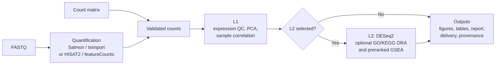

English | [繁體中文](README_zh-TW.md)

# nf-rna

`nf-rna` is a reproducible bulk RNA-seq workflow for FASTQ and raw-count projects. It validates the declared inputs and experimental design, runs the selected QC and analysis stages, and produces figures, tables, a technical report, a curated delivery package and frozen provenance for every run.

`rnaseq` is the control plane, Nextflow is the execution plane, and Conda provides every process environment. Docker is not required.

> **Current release: `v1.7.0`** ([changes](CHANGELOG.md#170--2026-11-06)). v1.7.0 turns the optional browser GUI into a local research workspace with PDF/TIFF figure downloads, redraws the standard-preset L2 figures, stops publishing HISAT2 lane SAMs and prepared FASTQs, and validates more strictly: **FASTQ sample IDs and contrast IDs must start with a letter or digit and contain only letters, digits, `.`, `_` and `-`**. Analysis values are identical to `v1.6.1`. Upgrading from an earlier release: read the [CHANGELOG](CHANGELOG.md) (v1.6.1 and v1.5.0 changed results). Documentation for older releases is at each release's Git tag; the v1.3.0 README is [archived](docs/archive/README_v1.3.0.md).

## Supported workflows



| Input | Quantification | Then |
|---|---|---|
| Gzipped FASTQ in `input/fastq/` | nf-core/rnaseq 3.26.0 with **Salmon + tximport**, or first-party **HISAT2 + featureCounts** | L1, optionally L2 |
| Gene-count matrix in `input/counts.csv` | none (counts are validated) | L1, optionally L2 |

- Project creation (`rnaseq new`) supports *Homo sapiens* and *Mus musculus*; GO/KEGG annotation uses `org.Hs.eg.db` / `org.Mm.eg.db`.
- Designs: two-group, paired two-group and multi-group, with optional categorical or continuous adjustment covariates (for example `~ batch + condition`).
- FASTQ projects need an execution-ready reference for the chosen route (`rnaseq reference register`, `prepare`, `prepare-hisat2`); see the [Quick Start](docs/quickstart.md#references-and-inputs).

## Requirements

- Linux x86-64, or Windows with WSL2 (native Windows and macOS are not supported).
- Python 3.11+, Git, Bash, Java 17+ and Nextflow ≥ 25.04.3 on `PATH`.
- Conda (for example Miniforge) with the `conda-forge` and `bioconda` channels in that order, as nf-core requires:
  `conda config --add channels bioconda && conda config --add channels conda-forge && conda config --set channel_priority strict`.
- Enough local storage for references, Conda environments and Nextflow work data (a 10-sample paired-end HISAT2 run can need 200–350 GB of work space).

R, DESeq2, tximport and the enrichment packages run in a locked Conda environment that nf-rna creates on first use; nf-core/rnaseq and HISAT2/featureCounts run in Conda environments created by Nextflow. You do not install them by hand.

## Installation

nf-rna is not published on PyPI. Install a release from its Git tag, so that pip records the exact source commit that every run must record (nf-rna refuses to run from an install without one):

```bash
conda create --yes --name nf-rna python=3.11
conda activate nf-rna
python -m pip install "git+https://github.com/2002brian/nf-rna.git@v1.7.0"
rnaseq --version          # 1.7.0
rnaseq doctor             # read-only check of Java, Nextflow, Conda, locks and source revision
```

For the browser GUI install the `gui` extra instead: `python -m pip install "nf-rna[gui] @ git+https://github.com/2002brian/nf-rna.git@v1.7.0"`.

## Quick start

There are two supported journeys; both start from the template written by `rnaseq new`.

**Staged L1 → L2** (default): run L1, review the QC, then configure and run L2.

```bash
rnaseq new                 # wizard: species, input, reference, design, known batch
cd <new-project>
# Add FASTQs to input/fastq/ (or a count matrix to input/counts.csv) and complete metadata.csv.
rnaseq validate .
rnaseq plan .
rnaseq run . --case-id L1-001 --profile local --yes
rnaseq status . --all      # the RUN column shows the run ID
rnaseq design .            # proposes contrasts, writes contrasts.csv, sets the scope to L2
rnaseq run . --case-id L2-001 --profile local --reuse-upstream L1-001/<run-id> --yes   # FASTQ projects
rnaseq run . --case-id L2-001 --profile local --yes                                    # count-matrix projects
```

**Direct L2**: choose `L2` in the wizard, then `rnaseq design .`, `rnaseq validate .` and one `rnaseq run`. An L2 run always includes the L1 QC.

**FASTQ names.** The sample ID is everything before the optional lane (`_L001`) and the read marker (`_R1`/`_R2`, optionally `_001`): `Ctrl1_S1_L001_R1_001.fastq.gz` belongs to sample `Ctrl1_S1`, and lanes of one sample are combined. Each `sample_id` in `metadata.csv` must match exactly.

`rnaseq run` runs in the foreground (hours for FASTQ projects); follow it from a second terminal with `rnaseq status . --watch`. Closing the terminal, Ctrl-C, shutdown or sleep interrupt it; use `tmux` or `nohup` to survive a closed terminal. The [Quick Start](docs/quickstart.md) covers the wizard, metadata templates, `rnaseq design`, upstream reuse, monitoring and cleanup in detail.

## L1: quality control

L1 removes all-zero and low-count genes, normalizes with DESeq2, and computes a blind VST for PCA (with batch-coloured PCA when a batch is declared), Pearson sample correlation, and per-sample boxplots of log2(raw count + 1) and of VST values, with their statistics in `sample_distribution_qc.tsv`. L1 needs no contrasts and makes no differential-expression inference. Plotted values are never batch-corrected, and L1 never removes samples.

## L2: differential expression

L2 fits the validated additive design with DESeq2 and extracts each contrast in `contrasts.csv` in the declared `numerator / denominator` direction. The design is checked before execution (full rank, residual degrees of freedom, complete pairs for paired designs). A gene is a DEG when `padj < thresholds.padj` and the raw (unshrunken) `|log2FoldChange| ≥ thresholds.abs_log2fc`, both set in `project.yaml`; independent filtering uses `alpha = thresholds.padj`. Shrunken LFCs (apeglm, or ashr) are added for display and ranking only. Each contrast writes all-gene, significant, up- and down-regulated tables with gene symbols and group means, a volcano plot, an MA plot and a DEG heatmap. Multi-group projects get every pairwise contrast; adjusted p-values are not corrected across contrasts.

## GO/KEGG enrichment

Independently selectable for L2: GO ORA, KEGG ORA and preranked GO (BP, MF, CC) and KEGG GSEA, with clusterProfiler. A term is significant when the Benjamini–Hochberg adjusted P is ≤ 0.05. The ORA universe is the genes with a non-NA DESeq2 `padj`, mapped to Entrez and intersected with the gene-set database. GSEA is ranked by the Wald statistic with a recorded seed. KEGG gene sets come from a local KEGG REST snapshot (`~/.cache/nf-rna/genesets/kegg/`): **pin it for results you will publish** with `annotation.enrichment.kegg.snapshot` in `project.yaml` (`rnaseq validate` reports the snapshot ID). Details: [Scientific contract](docs/scientific_contract.md).

## Command line and GUI

| Command | Purpose |
|---|---|
| `rnaseq new` | create a project (wizard, or explicit flags such as `--metadata`, `--covariate`) |
| `rnaseq validate` / `rnaseq plan` | validate inputs and design; write planning artifacts |
| `rnaseq design` | propose and confirm L2 contrasts |
| `rnaseq doctor` | read-only prerequisite and runtime check |
| `rnaseq run` / `rnaseq retry` | execute an immutable run; retry a FAILED or INTERRUPTED one |
| `rnaseq status` | execution dashboard (`--watch`, `--all`) |
| `rnaseq clean` | remove a finished run's Nextflow work directory (the run record is kept) |
| `rnaseq reference` | prepare, register or adopt managed references |
| `rnaseq gui` | start the optional browser GUI |

`rnaseq gui` serves a Streamlit workspace on `127.0.0.1:8501`: dataset browser, project overview, metadata and contrast editors, validation, L1/L2 runs with run history, execution status shown separately from scientific QC, results browsing, and PNG/PDF/TIFF downloads. It uses the same validators and run services as the CLI, so GUI runs are ordinary `rnaseq run` runs. From a laptop, forward the port with `ssh -N -L 8501:127.0.0.1:8501 user@server`. See [Browser GUI](docs/gui.md).

## Outputs and delivery

Every execution creates an immutable run that is never overwritten: running a case ID again adds a new run.

```text
runs/<case-id>/<run-id>/
├── frozen/          configuration, inputs and contracts as executed
├── upstream/        FASTQ projects: QC and the Salmon or featureCounts outputs
├── handoff/         validated count handoff between upstream and downstream
├── downstream_inputs/
├── downstream/      L1 QC and L2 contrast, enrichment and figure outputs
├── delivery/        curated package: report, README, figures (PNG, PDF, TIFF), tables,
│                    counts, MultiQC, methods and versions, delivery manifest
├── provenance/      run provenance
├── logs/
└── run_state.json
```

The run ID is the start time in Asia/Taipei time (`YYYYMMDD-HHMMSS+0800`). Nextflow work directories live outside `runs/` and are removed only by `rnaseq clean`. Layout and environment variables: [Runtime](docs/runtime.md#filesystem-layout).

## Reproducibility

Every run records the nf-rna source commit, the downstream Conda lock and its SHA-256, the installed wheel SHA-256, the bundled R-script inventory, the workflow hashes, the nf-core/rnaseq version and revision, and the reference manifest and checksums. nf-rna refuses to start when the source commit is unknown or the checkout has uncommitted changes. Install an explicit release tag for formal analyses. Releases pass a scientific CI gate on the locked runtime that checks DESeq2 designs, independent and low-count filtering, tximport input and enrichment identifier mapping, comparing against independent oracle scripts for DESeq2, tximport and annotation ([Scientific CI](docs/dev/scientific_ci.md)).

### Known limitations

- `--reuse-upstream` accepts only a SUCCESS run of the same project, nf-rna version, frozen parameters, inputs and reference; a v1.6.1 upstream must be rerun once. Do not `rnaseq retry` a run interrupted before its upstream handoff was frozen; start a new `--reuse-upstream` run.
- An unpinned KEGG snapshot follows the latest local snapshot, so KEGG results can change.
- A FASTQ's SHA-256 is reused while its path, size and mtime are unchanged; replace FASTQs by new files rather than editing them in place.
- A low-depth project with ≥ 1,000 retained genes but fewer than 1,000 with mean normalized count > 5 stops in L1 (DESeq2 `vst()`).
- DEG calls are effect-size filtered (Wald test of LFC = 0, then |LFC| threshold), not a thresholded test.
- The GUI is single-user on 127.0.0.1 with one active GUI run, has no stop button, and copies assigned FASTQs into the project. PDF and raster figure layouts can differ by a few points.

All limitations: [CHANGELOG](CHANGELOG.md#170--2026-11-06) and [Browser GUI](docs/gui.md#known-limitations-v170).

## Documentation

- **Users:** [Quick Start](docs/quickstart.md) · [Browser GUI](docs/gui.md) · [Runtime and reproducibility](docs/runtime.md) · [Scientific contract](docs/scientific_contract.md) · [Figure standard](docs/figure-standard.md) · [CHANGELOG](CHANGELOG.md)
- **Developers:** [Development installation and tests](docs/development.md) · [Architecture](docs/architecture.md) · [Scientific CI](docs/dev/scientific_ci.md) · [Development records](docs/dev/)
- **Archive:** [v1.3.0 README](docs/archive/README_v1.3.0.md); documentation of any release is at its tag.

Full index: [docs/README.md](docs/README.md).

## License and citation

nf-rna is released under the [MIT License](LICENSE). If you use it, cite the repository and the release you used ([CITATION.cff](CITATION.cff); GitHub's *Cite this repository* button reads it).
