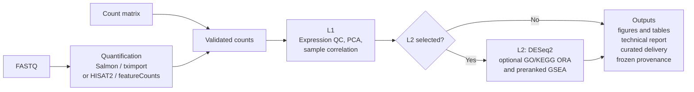

English | [繁體中文](README_zh-TW.md)

# nf-rna

`nf-rna` is a reproducible bulk RNA-seq workflow for FASTQ and raw-count projects. It validates declared inputs and design, performs the selected QC and analysis stages, and produces figures, tables, a technical report, and frozen provenance.

`rnaseq` is the control plane, Nextflow is the execution plane, and Conda provides every process environment. The supported runtime for v1.3.0 is **Linux x86-64 or Windows WSL2, with Nextflow and Conda**; Docker is not required. Production users enter through `rnaseq`; they do not invoke internal Nextflow modules.

## Features

- FASTQ projects using nf-core/rnaseq with Salmon/tximport or first-party HISAT2 + featureCounts.
- Raw-count projects with validated metadata, explicit contrasts, QC, differential expression, and optional GO/KEGG ORA and preranked GSEA.
- Immutable runs with frozen configuration, the exact nf-rna source commit, the locked Conda runtime identity, workflow hashes, and curated delivery artifacts.

## Architecture

nf-rna provides one validated, count-based downstream workflow for two input routes. FASTQ projects first perform upstream quantification; count-matrix projects enter the downstream path after their supplied counts are validated. Both routes converge on the same expression analysis.



L1 provides expression quality control and exploration. L2 is explicitly selected: it performs DESeq2 for declared contrasts and may be followed independently by GO ORA, KEGG ORA, and preranked GO/KEGG GSEA; it is never inferred from metadata or contrasts. Each route produces figures, tables, a technical report, curated delivery artifacts, and frozen provenance.

## Inputs and outputs

### Inputs

- **FASTQ:** place reads in `input/fastq/`. FASTQ projects quantify with the selected Salmon/tximport or HISAT2 + featureCounts route and require an execution-ready reference compatible with that route.
- **Count matrix:** place an imported gene-count matrix in `input/counts.csv` when quantification was completed elsewhere and nf-rna should perform the validated downstream analysis.
- **Design files:** `metadata.csv` provides sample IDs and design variables; `contrasts.csv` declares the directional contrasts used by L2. `rnaseq new` writes both as templates (a header-only `metadata.csv` with standard column names, and a header-only `contrasts.csv`); `rnaseq design` fills in `contrasts.csv` from your completed metadata.
- **References:** FASTQ projects declare the selected reference route explicitly. Reference identity and checksums are validated and frozen with the run rather than inferred from local files.

### Outputs

Every authorized execution creates an immutable run under `runs/<case-id>/<run-id>/`. The run keeps frozen inputs and configuration, the nf-rna source commit, Conda runtime and workflow identity, and provenance alongside its analysis artifacts.

- **Upstream count data:** FASTQ projects retain upstream QC and the Salmon/tximport or featureCounts count handoff; count-matrix projects retain their validated imported count source.
- **L1 QC:** filtering and normalization records, transformed expression for visualization, PCA, sample correlation, and QC tables and figures.
- **L2 results:** when selected, DESeq2 results for each declared contrast, with associated tables and figures.
- **Enrichment:** independently enabled GO ORA, KEGG ORA, and preranked GO (BP, MF, CC)/KEGG GSEA results. ORA uses the mapped statistically tested-gene universe for each contrast.
- **Delivery:** a technical HTML report and a curated delivery package of figures, tables, methods/version records, provenance, and a delivery manifest.

## Requirements

Use a Linux x86-64 workstation or Windows with WSL2 (native Windows and macOS are not supported by v1.3.0) with:

- Python 3.11+ and Git;
- Conda (for example Miniforge) on `PATH`, with the `conda-forge` and `bioconda` channels configured in that order, as nf-core requires (`conda config --add channels bioconda && conda config --add channels conda-forge && conda config --set channel_priority strict`);
- Bash, Java 17+, and Nextflow on `PATH`; and
- sufficient local storage for references, Conda environments, and Nextflow work data.

Docker is not required. Java, Nextflow, and Conda run on the host. nf-core/rnaseq 3.26.0 runs with `-profile conda`; HISAT2/featureCounts use an exactly pinned Conda environment; R, DESeq2, tximport, and the enrichment packages run in a locked linux-64 Conda environment that nf-rna creates on first use. Normal users do not install these tools by hand. See the [Nextflow installation guide](https://docs.seqera.io/nextflow/install).

## Installation

nf-rna has no PyPI distribution. Install the released CLI from its Git tag.
Installing from Git lets pip record the exact source commit, which every run
must record; nf-rna refuses to run from an install that has no commit, such as
a plain directory, sdist, or wheel install. Replace `X.Y.Z` with the released
version you intend to use:

```bash
RELEASE_VERSION=X.Y.Z
conda create --yes --name nf-rna python=3.11
conda activate nf-rna
python -m pip install --upgrade pip
python -m pip install "git+https://github.com/2002brian/nf-rna.git@v${RELEASE_VERSION}"
rnaseq --version
rnaseq doctor
```

The first run creates the locked downstream Conda environment under the nf-rna
runtime cache (one environment per lock and installed nf-rna build); later runs
reuse it. nf-core/rnaseq and HISAT2/featureCounts process environments are
created by Nextflow in a shared upstream Conda cache.

The release contract is deliberate:

```text
CLI X.Y.Z  ↔  Git tag vX.Y.Z  ↔  one source commit, recorded in every run
```

`rnaseq doctor` is read-only: it checks Java, Nextflow, Conda and its channel
configuration, the nf-core/rnaseq pin, the downstream Conda lock, and the nf-rna
source revision, then prints `Overall: READY` or `Overall: NOT READY` (exit code 1).
It does not create environments or download pipelines.

### Historical Docker releases

Releases `v1.1.2` through `v1.2.1` ran their processes in Docker and published
official images as `ghcr.io/2002brian/nf-rna:X.Y.Z`, qualified for
`linux/amd64`. `v1.2.1` is the last Docker-based release; v1.3.0 does not
require or qualify a Docker image. `v1.0.0` predates GHCR publication, and
`v1.1.0`/`v1.1.1` remain valid source releases without official images because
their publication workflows stopped before image build or push.

## Quick Start

The normal journey is template-first: the wizard writes templates, you fill in `metadata.csv`, run L1 for QC, then let `rnaseq design` prepare L2.

```text
rnaseq new
  -> fill metadata.csv
  -> rnaseq validate
  -> run L1
  -> review QC
  -> rnaseq design PROJECT
  -> run L2
```

```bash
mkdir -p ~/projects/rnaseq-projects
cd ~/projects/rnaseq-projects
rnaseq new                 # choose the design and whether there is a known technical batch
cd <new-project>
# Add FASTQs to input/fastq/, or a count matrix to input/counts.csv, and complete metadata.csv.
rnaseq validate .
rnaseq plan .
rnaseq doctor .
rnaseq run . --case-id L1-001 --profile local --yes     # L1: QC and exploratory analysis
# Review the L1 QC: sample boxplots, PCA, library sizes. Then set up differential expression:
rnaseq design .            # reads metadata.csv, shows the model, proposes contrasts, asks for confirmation (also refreshes the plan)
rnaseq run . --case-id L2-001 --profile local --yes     # L2: differential expression
rnaseq status .            # execution dashboard of the latest run
rnaseq status . --watch    # redraw until the run finishes (Ctrl-C stops watching only)
rnaseq status . --all      # one line per recorded run
rnaseq clean . --case-id L1-001 --run <run-id>   # free a finished run's Nextflow work
```

### What the wizard asks, and what the templates contain

`rnaseq new` asks only what cannot be read from your metadata later: the design (two-group, paired two-group, or multi-group), the pairing column for paired designs, and one yes/no question: *is there a known technical batch?* It never asks for condition levels, batch levels, a reference level, or contrasts. The generated `metadata.csv` header depends on those answers:

| Design | Known batch | `metadata.csv` header | Provisional model |
|---|---|---|---|
| two-group / multi-group | no | `sample_id,condition` | `~ condition` |
| two-group / multi-group | yes | `sample_id,condition,batch` | `~ batch + condition` |
| paired | no | `sample_id,<pair_id>,condition` | `~ <pair_id> + condition` |
| paired | yes | `sample_id,<pair_id>,condition,batch` | `~ <pair_id> + batch + condition` |

`contrasts.csv` starts as the header only: `contrast_id,factor,numerator,denominator`. Both files are ordinary CSV files you can open and edit. The same choices are available non-interactively as `--design-type`, `--pair-id`, and `--batch/--no-batch`.

### L1: QC and exploratory analysis

L1 needs no contrasts. It produces the raw-count and VST sample boxplots, PCA, sample correlations, and library-size QC. L1 is QC/exploratory only:

- A `batch` term in the provisional model does **not** mean the plotted values are batch-corrected. No `removeBatchEffect` or corrected expression matrix is created; boxplots and PCA are always uncorrected, and a `batch` column is shown only as an annotation.
- nf-rna never uses these plots to decide whether batch belongs in the model; you declare known batch at project creation.
- Formal differential inference happens in L2.

### `rnaseq design`: from L1 to L2

After reviewing L1, `rnaseq design PROJECT` reads the completed `metadata.csv` and prepares L2:

- It validates the design before anything is written: the model matrix must be full rank (no perfectly confounded batch and condition, and for a paired design batch must vary within pairs) and must leave residual degrees of freedom after categorical variables are expanded. Partial confounding and single-sample batches are reported as warnings, and the batch-by-condition sample counts are shown.
- **Two-group:** it reads the two condition levels in the order they first appear in `metadata.csv` and proposes *later vs earlier*, for example `Treatment_vs_Control` (log2FC > 0 = higher in Treatment). Answer `y` to accept, `swap` to reverse the direction, or `n` to change nothing (`--yes`, `--swap` for non-interactive use). `swap` changes only the contrast in `contrasts.csv` (the authority on direction); `design.condition_order` stays the first-appearance (or `--condition-order`) order.
- **Multi-group:** it generates every pairwise contrast, later level vs earlier level, in first-appearance order. For `Control, DrugA, DrugB` it writes `DrugA_vs_Control`, `DrugB_vs_Control`, `DrugB_vs_DrugA`. k levels give k(k-1)/2 contrasts. There is no per-comparison selection; edit `contrasts.csv` to remove comparisons. Per-contrast adjusted p-values are not corrected across contrasts.
- Use `--condition-order Control,DrugA,DrugB` to set the order explicitly (reference level first).
- Only after you confirm does it write `contrasts.csv`, freeze the order as `design.condition_order` in `project.yaml` (so re-sorting metadata rows later cannot flip a contrast), and set the scope to `L2`. The project's `project.yaml` formula stays as derived: `~ batch + condition`, or `~ <pair_id> + batch + condition` for paired designs.
- An existing non-empty `contrasts.csv` is never overwritten unless you pass `--force`. QC-only projects and projects with invalid metadata/design are refused. A project already set to L2 with empty contrasts is accepted.

Final results are delivered to `runs/<case-id>/<run-id>/delivery/`. Each run's disposable Nextflow work directory (often hundreds of GB for FASTQ runs) is kept until you remove it with `rnaseq clean`; see [Runtime](docs/runtime.md#nextflow-work-directories-and-rnaseq-clean). New projects use hardware-aware automatic CPU/memory limits (`execution.max_cpus: auto`, `execution.max_memory_gb: auto`); explicit integer limits in `project.yaml` are preserved.

The wizard creates a project scaffold; it does not infer scientific inputs. FASTQ projects also need an execution-ready reference. Register an existing checksum-bound managed reference with `rnaseq reference register /absolute/reference-root`, or configure a supported reference route. See the [detailed Quick Start](docs/quickstart.md).

## Covariate-aware DESeq2 designs

New schema 1.3 projects declare the type of every additive formula variable. Categorical variables are fitted as R factors; continuous variables are finite numeric adjustment covariates. Existing schema 1.0–1.2 projects remain readable with their historical categorical/clearly numeric behavior.

```yaml
design:
  type: multi_group
  formula: "~ batch + age + condition"
  variables:
    batch: categorical
    age: continuous
    condition: categorical
```

Supported additive examples are `~ condition`, `~ age + condition`, `~ batch + condition`, and `~ batch + age + condition`. Contrasts remain categorical and directional—for example `Treatment_vs_Control,condition,Treatment,Control`; a continuous variable adjusts the estimate and cannot be used as a numerator/denominator contrast.

### Advanced: imported metadata, custom covariates, contrasts, and formulas

The simple wizard covers `condition` and an optional `batch`. For anything else, import your own files with explicit flags (flags-only; the wizard never imports): `--metadata`, `--contrasts`, `--condition-column`, `--covariate batch` for categorical adjustments, `--continuous-covariate age` for numeric adjustments, and `--pair-id`. `--batch` with `--metadata` is shorthand for `--covariate batch`. These options are never ignored: without `--metadata` they are rejected with an explanation, and a metadata file with no `condition` column requires `--condition-column`. Imported contrasts are preserved, and `rnaseq design` will not replace them unless you pass `--force`; a formula that is not the standard derivation is kept as written.

Known batch belongs in the DESeq2 design (`~ batch + condition`), not in a batch-corrected raw count matrix. nf-rna preserves original counts for inference, records the fitted typed design in provenance and reports, and adds batch metadata (plus a batch-colored PCA when `batch` is declared categorical) to exploratory VST QC. Continuous-effect hypothesis tests are outside this milestone.

## Reproducibility

Every run records the nf-rna source commit, the downstream Conda lock and its SHA-256, the installed nf-rna wheel SHA-256, the bundled R-script inventory, the nf-core/rnaseq version and revision, and the reference manifest and file checksums. nf-rna refuses to start a run when the source commit is unknown or the source checkout has uncommitted changes.

For formal analyses, install an explicit release tag. `rnaseq doctor PROJECT` reports the source revision, the Conda lock, and the provisioned runtime before you run.

## Documentation

- [Detailed Quick Start and v1.0.0 compatibility](docs/quickstart.md)
- [Runtime and reproducibility contract](docs/runtime.md)
- [Scientific contract](docs/scientific_contract.md)
- [Architecture](docs/architecture.md)

## Development

Cloning the source, editable installation, and tests are contributor activities. See [Development installation](docs/development.md).
