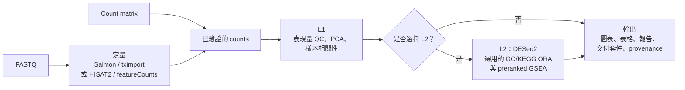

[English](README.md) | 繁體中文

# nf-rna

`nf-rna` 是可重現的 bulk RNA-seq 分析流程，支援 FASTQ 與 raw-count 專案。它會驗證宣告的輸入資料與實驗設計，執行選定的 QC 與分析階段，並為每次 run 產生圖表、表格、技術報告、整理好的交付套件（delivery package）與凍結的 provenance。

`rnaseq` 是控制層（control plane），Nextflow 是執行層（execution plane），所有 process 環境都由 Conda 提供，不需要 Docker。

> **目前版本：`v1.7.0`**（[變更內容](CHANGELOG.md#170--2026-11-06)）。v1.7.0 將選用的瀏覽器 GUI 擴充為本機研究工作區，並提供 PDF/TIFF 圖檔下載；standard preset 的 L2 圖表重新繪製；HISAT2 路線不再發布 lane SAM 與 prepared FASTQ；驗證更嚴格：**FASTQ 的 sample ID 與 contrast ID 必須以英文字母或數字開頭，且只能包含英文字母、數字、`.`、`_` 與 `-`**。分析數值與 `v1.6.1` 完全相同。從較早版本升級前，請先閱讀 [CHANGELOG](CHANGELOG.md)（v1.6.1 與 v1.5.0 曾改變分析結果）。舊版文件請見各版本的 Git tag；v1.3.0 的 README 已[封存](docs/archive/README_v1.3.0.md)。

## 支援的分析流程



| 輸入 | 定量方式 | 後續 |
|---|---|---|
| `input/fastq/` 中的 gzip FASTQ | nf-core/rnaseq 3.26.0 的 **Salmon + tximport**，或 nf-rna 自有的 **HISAT2 + featureCounts** | L1，可選 L2 |
| `input/counts.csv` 中的 gene-count matrix | 無（驗證提供的 counts） | L1，可選 L2 |

- 建立專案（`rnaseq new`）支援 *Homo sapiens* 與 *Mus musculus*；GO/KEGG 註解使用 `org.Hs.eg.db` / `org.Mm.eg.db`。
- 實驗設計：兩組、成對兩組（paired）與多組，可加入類別型或連續型校正共變數（例如 `~ batch + condition`）。
- FASTQ 專案需要與所選路線相容、可直接執行的 reference（`rnaseq reference register`、`prepare`、`prepare-hisat2`），見 [Quick Start](docs/quickstart.md#references-and-inputs)。

## 系統需求

- Linux x86-64，或 Windows 的 WSL2（不支援原生 Windows 與 macOS）。
- `PATH` 上需有 Python 3.11+、Git、Bash、Java 17+ 與 Nextflow ≥ 25.04.3。
- Conda（例如 Miniforge），並依 nf-core 要求依序設定 `conda-forge` 與 `bioconda` channel：
  `conda config --add channels bioconda && conda config --add channels conda-forge && conda config --set channel_priority strict`。
- 足夠的本機空間存放 reference、Conda 環境與 Nextflow 工作資料（10 個樣本的 paired-end HISAT2 run 可能需要 200–350 GB 的工作空間）。

R、DESeq2、tximport 與 enrichment 套件在 nf-rna 首次使用時建立的 locked Conda 環境中執行；nf-core/rnaseq 與 HISAT2/featureCounts 則在 Nextflow 建立的 Conda 環境中執行。這些工具都不需要手動安裝。

## 安裝

nf-rna 沒有發布到 PyPI。請從 Git tag 安裝正式版本，讓 pip 記錄每次 run 都必須記錄的 source commit（沒有 commit 的安裝方式，nf-rna 會拒絕執行）：

```bash
conda create --yes --name nf-rna python=3.11
conda activate nf-rna
python -m pip install "git+https://github.com/2002brian/nf-rna.git@v1.7.0"
rnaseq --version          # 1.7.0
rnaseq doctor             # 唯讀檢查 Java、Nextflow、Conda、lock 與 source revision
```

若要使用瀏覽器 GUI，請改為安裝 `gui` extra：`python -m pip install "nf-rna[gui] @ git+https://github.com/2002brian/nf-rna.git@v1.7.0"`。

## 快速開始

有兩種支援的流程，都從 `rnaseq new` 產生的範本開始。

**分段 L1 → L2**（預設）：先跑 L1，檢視 QC 後再設定並執行 L2。

```bash
rnaseq new                 # 精靈：物種、輸入、reference、實驗設計、是否有已知 batch
cd <new-project>
# 將 FASTQ 放入 input/fastq/（或將 count matrix 放入 input/counts.csv），並填好 metadata.csv。
rnaseq validate .
rnaseq plan .
rnaseq run . --case-id L1-001 --profile local --yes
rnaseq status . --all      # RUN 欄位顯示 run ID
rnaseq design .            # 提出 contrast、寫入 contrasts.csv，並將 scope 設為 L2
rnaseq run . --case-id L2-001 --profile local --reuse-upstream L1-001/<run-id> --yes   # FASTQ 專案
rnaseq run . --case-id L2-001 --profile local --yes                                    # count-matrix 專案
```

**直接 L2**：在精靈中選擇 `L2`，接著執行 `rnaseq design .`、`rnaseq validate .`，再執行一次 `rnaseq run`。L2 run 一定包含 L1 QC。

**FASTQ 檔名。** sample ID 是選用的 lane（`_L001`）與 read 標記（`_R1`/`_R2`，可接 `_001`）之前的所有文字：`Ctrl1_S1_L001_R1_001.fastq.gz` 屬於樣本 `Ctrl1_S1`，同一樣本的多個 lane 會合併。`metadata.csv` 中的 `sample_id` 必須完全一致。

`rnaseq run` 在前景執行（FASTQ 專案可能需要數小時）；請在另一個終端機以 `rnaseq status . --watch` 追蹤。關閉終端機、Ctrl-C、關機或睡眠都會中斷 run；需要在關閉終端機後繼續執行時，請使用 `tmux` 或 `nohup`。精靈、metadata 範本、`rnaseq design`、upstream 重用、監看與清理的詳細說明請見 [Quick Start](docs/quickstart.md)（英文）。

## L1：品質控制

L1 會移除全為零與低 count 的基因，以 DESeq2 進行 normalization，並以 blind VST 計算 PCA（宣告 batch 時另有依 batch 著色的 PCA）、Pearson 樣本相關性，以及 log2(raw count + 1) 與 VST 值的逐樣本 boxplot，統計值寫入 `sample_distribution_qc.tsv`。L1 不需要 contrast，也不做差異表現推論。圖中數值一律未經 batch 校正，L1 也不會自動移除樣本。

## L2：差異表現分析

L2 以 DESeq2 擬合已驗證的加成式（additive）設計，並依宣告的 `numerator / denominator` 方向取出 `contrasts.csv` 中的每個 contrast。執行前會檢查設計（full rank、殘差自由度、paired 設計的配對完整性）。基因判定為 DEG 的條件是 `padj < thresholds.padj` 且未經 shrinkage 的 `|log2FoldChange| ≥ thresholds.abs_log2fc`，兩個門檻都設定在 `project.yaml`；independent filtering 使用 `alpha = thresholds.padj`。shrunken LFC（apeglm 或 ashr）僅用於顯示與排序。每個 contrast 會輸出全部基因、顯著、上調與下調表格（含 gene symbol 與組平均）、volcano plot、MA plot 與 DEG heatmap。多組專案會產生所有兩兩比較；adjusted p-value 不會跨 contrast 再校正。

## GO/KEGG 富集分析

L2 可分別啟用 GO ORA、KEGG ORA，以及 preranked GO（BP、MF、CC）與 KEGG GSEA，使用 clusterProfiler。term 在 Benjamini–Hochberg adjusted P ≤ 0.05 時判定為顯著。ORA universe 為 DESeq2 `padj` 非 NA 的基因，轉換為 Entrez 後再與 gene-set 資料庫取交集。GSEA 以 Wald 統計量排序，並記錄 seed。KEGG gene set 來自本機的 KEGG REST snapshot（`~/.cache/nf-rna/genesets/kegg/`）：**要發表的結果請固定（pin）snapshot**，在 `project.yaml` 設定 `annotation.enrichment.kegg.snapshot`（snapshot ID 由 `rnaseq validate` 顯示）。詳見 [Scientific contract](docs/scientific_contract.md)。

## 命令列與 GUI

| 指令 | 用途 |
|---|---|
| `rnaseq new` | 建立專案（精靈，或使用 `--metadata`、`--covariate` 等明確參數） |
| `rnaseq validate` / `rnaseq plan` | 驗證輸入與設計；寫入 planning 檔案 |
| `rnaseq design` | 提出並確認 L2 contrast |
| `rnaseq doctor` | 唯讀檢查執行前提與 runtime |
| `rnaseq run` / `rnaseq retry` | 執行 immutable run；重試 FAILED 或 INTERRUPTED 的 run |
| `rnaseq status` | 執行狀態面板（`--watch`、`--all`） |
| `rnaseq clean` | 移除已結束 run 的 Nextflow 工作目錄（保留 run 紀錄） |
| `rnaseq reference` | 準備、註冊或採用受管理的 reference |
| `rnaseq gui` | 啟動選用的瀏覽器 GUI |

`rnaseq gui` 在 `127.0.0.1:8501` 提供 Streamlit 工作區：資料集瀏覽、專案總覽、metadata 與 contrast 編輯、驗證、L1/L2 run 與 run 歷史、分開顯示的執行狀態與科學 QC、結果瀏覽，以及 PNG/PDF/TIFF 下載。GUI 使用與 CLI 相同的驗證與 run 服務，因此 GUI 啟動的 run 就是一般的 `rnaseq run`。從筆電連線時，以 `ssh -N -L 8501:127.0.0.1:8501 user@server` 轉送連接埠。詳見 [Browser GUI](docs/gui.md)（英文）。

## 輸出與交付

每次執行都會建立不會被覆寫的 immutable run：重複使用同一個 case ID 只會新增一個 run。

```text
runs/<case-id>/<run-id>/
├── frozen/          實際執行時的設定、輸入與 contract
├── upstream/        FASTQ 專案：QC 與 Salmon 或 featureCounts 的輸出
├── handoff/         upstream 與 downstream 之間已驗證的 count handoff
├── downstream_inputs/
├── downstream/      L1 QC，以及 L2 contrast、富集分析與圖表輸出
├── delivery/        交付套件：報告、README、圖檔（PNG、PDF、TIFF）、表格、
│                    counts、MultiQC、方法與版本紀錄、delivery manifest
├── provenance/      run provenance
├── logs/
└── run_state.json
```

run ID 為台北時間的開始時間（`YYYYMMDD-HHMMSS+0800`）。Nextflow 工作目錄位於 `runs/` 之外，只有 `rnaseq clean` 會移除。目錄配置與環境變數見 [Runtime](docs/runtime.md#filesystem-layout)（英文）。

## 可重現性

每次 run 都會記錄 nf-rna source commit、downstream Conda lock 及其 SHA-256、所安裝 wheel 的 SHA-256、內建 R script 清單、workflow hash、nf-core/rnaseq 版本與 revision，以及 reference manifest 與 checksum。source commit 不明或 checkout 有未 commit 的變更時，nf-rna 會拒絕開始執行。正式分析請安裝明確的 release tag。每個版本都須通過在 locked runtime 上執行的科學 CI 關卡，檢查 DESeq2 設計、independent filtering 與低 count 過濾、tximport 輸入與富集分析的 identifier 轉換，並與 DESeq2、tximport 與註解的獨立 oracle script 比對（[Scientific CI](docs/dev/scientific_ci.md)）。

### 已知限制

- `--reuse-upstream` 只接受同一專案、同一 nf-rna 版本，且凍結參數、輸入與 reference 都相同的 SUCCESS run；v1.6.1 的 upstream 需要重跑一次。若 run 在 upstream handoff 凍結前就被中斷，請不要 `rnaseq retry`，改為建立新的 `--reuse-upstream` run。
- 未固定的 KEGG snapshot 會跟著本機最新的 snapshot，因此 KEGG 結果可能改變。
- FASTQ 的 SHA-256 在路徑、大小與 mtime 不變時會重複使用；請以新檔案取代 FASTQ，不要原地修改。
- 保留基因 ≥ 1,000 個、但 mean normalized count > 5 的基因不到 1,000 個的低深度專案，會在 L1 中止（DESeq2 `vst()`）。
- DEG 判定是 effect-size 過濾（先以 Wald 檢定 LFC = 0，再套用 |LFC| 門檻），不是以門檻為虛無假設的檢定。
- GUI 為單一使用者、只監聽 127.0.0.1，同時只能有一個 GUI run，沒有停止按鈕，並會將指定的 FASTQ 複製到專案中。PDF 與點陣圖的版面可能相差幾 pt。

完整限制請見 [CHANGELOG](CHANGELOG.md#170--2026-11-06) 與 [Browser GUI](docs/gui.md#known-limitations-v170)。

## 文件

- **使用者：** [Quick Start](docs/quickstart.md) · [Browser GUI](docs/gui.md) · [Runtime 與可重現性](docs/runtime.md) · [Scientific contract](docs/scientific_contract.md) · [圖表標準](docs/figure-standard.md) · [CHANGELOG](CHANGELOG.md)
- **開發者：** [開發環境安裝與測試](docs/development.md) · [Architecture](docs/architecture.md) · [Scientific CI](docs/dev/scientific_ci.md) · [開發紀錄](docs/dev/)
- **封存：** [v1.3.0 README](docs/archive/README_v1.3.0.md)；任一版本的文件請見其 Git tag。

完整索引：[docs/README.md](docs/README.md)。上述文件除本頁外皆為英文。

## 授權與引用

nf-rna 以 [MIT License](LICENSE) 發布。使用時請引用本 repository 與所使用的版本（[CITATION.cff](CITATION.cff)；GitHub 的 *Cite this repository* 按鈕會讀取此檔）。
