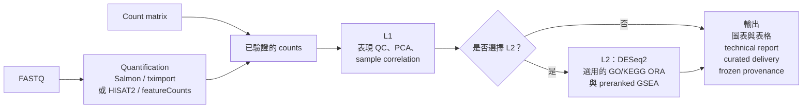

[English](README.md) | 繁體中文

# nf-rna

`nf-rna` 是可重現的 bulk RNA-seq workflow，支援 FASTQ 與 raw-count 專案。它會驗證已宣告的輸入與實驗設計，執行選定的 QC 與分析階段，並產生圖表、表格、technical report 與凍結的 provenance。

`rnaseq` 是 control plane，Nextflow 是 execution plane，所有 process 環境皆由 Conda 提供。v1.6.0 支援的 runtime 為 **Linux x86-64 或 Windows WSL2，搭配 Nextflow 與 Conda**，不需要 Docker。production 使用者透過 `rnaseq` 執行，不需要呼叫內部 Nextflow module。

## 功能

- FASTQ 專案可使用 nf-core/rnaseq 的 Salmon/tximport，或 first-party HISAT2 + featureCounts。
- Raw-count 專案提供已驗證 metadata、明確 contrast、QC、differential expression，以及選用的 GO/KEGG ORA 與 preranked GSEA。
- Immutable run 會凍結設定、精確的 nf-rna source commit、locked Conda runtime identity、workflow hash，並建立 curated delivery artifact。

## 架構

nf-rna 為兩種輸入路徑提供同一套經驗證、以 count 為基礎的下游分析流程。FASTQ 專案會先進行上游定量；count-matrix 專案則在驗證提供的 count 後進入下游路徑。兩條路徑會匯入相同的 expression analysis。



L1 提供表現品質控制與探索。L2 必須明確選擇：它會對已宣告的 contrast 執行 DESeq2，之後可各自獨立進行 GO ORA、KEGG ORA 與 preranked GO/KEGG GSEA；不會從 metadata 或 contrast 推測是否應執行 L2。每條路徑都會產生圖表、表格、technical report、curated delivery artifact 與 frozen provenance。

## 輸入與輸出

### 輸入

- **FASTQ：** 將 reads 放入 `input/fastq/`。FASTQ 專案會使用所選的 Salmon/tximport 或 HISAT2 + featureCounts route 進行 quantification，並需要與該 route 相容且 execution-ready 的 reference。
- **Count matrix：** 若 quantification 已在其他地方完成，且希望 nf-rna 執行已驗證的 downstream analysis，請將 imported gene-count matrix 放入 `input/counts.csv`。
- **Design 檔案：** `metadata.csv` 提供 sample ID 與 design variable；`contrasts.csv` 宣告 L2 使用的 directional contrast。`rnaseq new` 只寫入範本（標準欄位名稱的 header-only `metadata.csv` 與 header-only `contrasts.csv`），`rnaseq design` 會依你填好的 metadata 產生 `contrasts.csv`。
- **Reference：** FASTQ 專案明確宣告所選 reference route。reference identity 與 checksum 會在 run 中驗證並凍結，而不會從本機檔案推測。

### 輸出

每次授權執行都會在 `runs/<case-id>/<run-id>/` 建立 immutable run。run 會保留凍結的 inputs 與 configuration、nf-rna source commit、Conda runtime 與 workflow identity，以及 provenance 和分析 artifact。

- **Upstream count data：** FASTQ 專案保留 upstream QC 與 Salmon/tximport 或 featureCounts 的 count handoff；count-matrix 專案保留已驗證的 imported count source。
- **L1 QC：** filtering 與 normalization 記錄、用於 visualization 的 transformed expression、PCA、sample correlation，以及 QC table 與 figure。兩張逐樣本 boxplot 用來比較樣本分布：`boxplot_log2_raw_counts`（normalization 前的 log2(raw count + 1)，呈現定序深度與組成差異）與 `boxplot_vst`（PCA 與 correlation 使用的 blind VST 值，呈現 normalization 後樣本是否對齊）。每個樣本的 Tukey box 統計值記錄於 `sample_distribution_qc.tsv`。圖中數值一律未做 batch correction。
- **L2 結果：** 選擇 L2 時，針對每個已宣告 contrast 的 DESeq2 result，以及相關 table 與 figure。
- **Enrichment：** 在 L2 可獨立啟用 GO ORA、KEGG ORA 與 preranked GO（BP、MF、CC）/KEGG GSEA。自 v1.5 起，term 以 p.adjust（Benjamini-Hochberg）≤ 0.05 判定為顯著；ORA universe 為 DESeq2 padj 非 NA 的基因，mapping 為 Entrez 後再與 gene-set 資料庫取交集。KEGG gene set 來自本機的 KEGG REST snapshot（`~/.cache/nf-rna/genesets/kegg/`）；未固定（pin）時使用最新的本機 snapshot，`rnaseq validate` 會標示為「未固定」。**要發表的結果，請在 `project.yaml` 以 `annotation.enrichment.kegg.snapshot: <snapshot ID>` 固定 snapshot**（ID 由 `rnaseq validate` 顯示，並記錄於 KEGG provenance）。
- **Delivery：** technical HTML report，以及包含 figure、table、methods/version record、provenance 與 delivery manifest 的 curated delivery package。

## 系統需求

請使用 Linux x86-64 workstation，或 Windows 的 WSL2（v1.6.0 不支援 native Windows 與 macOS），並準備：

- Python 3.11+ 與 Git；
- 位於 `PATH` 的 Conda（例如 Miniforge），並依 nf-core 要求依序設定 `conda-forge` 與 `bioconda` channel（`conda config --add channels bioconda && conda config --add channels conda-forge && conda config --set channel_priority strict`）；
- 位於 `PATH` 的 Bash、Java 17+ 與 Nextflow；以及
- 足夠儲存 reference、Conda environment 與 Nextflow work data 的本機空間。

不需要 Docker。Java、Nextflow 與 Conda 在 host 執行。nf-core/rnaseq 3.26.0 以 `-profile conda` 執行；HISAT2/featureCounts 使用精確 pin 的 Conda environment；R、DESeq2、tximport 與 enrichment 套件在 nf-rna 首次使用時建立的 locked linux-64 Conda environment 中執行。一般使用者不需要手動安裝這些工具。請參考 [Nextflow 官方文件](https://docs.seqera.io/nextflow/install)。

## 安裝

> **最新的穩定 release：`v1.6.0`。** 本 README 說明此版本（見 [CHANGELOG](CHANGELOG.md#160--2026-10-30)）：新增選用的瀏覽器 GUI，並包含 v1.5.1 的測試修正（v1.5.1 未單獨 tag）。分析內容與 `v1.5.0` 完全相同。**從 `v1.4.x` 升級：** v1.5.0 變更了 enrichment 顯著性判定（見 [1.5.0 變更](CHANGELOG.md#150--2026-10-30)）：DEG 表格加入 gene symbol、normalized count 組平均與 shrunken log2 fold change，新增 MA plot 與 300 dpi 圖檔；GO/KEGG ORA 與 GSEA 的顯著性改為 Benjamini-Hochberg adjusted p-value ≤ 0.05，KEGG gene set 來自本機 snapshot，發表用結果請固定（pin）該 snapshot。DESeq2 統計量與 DEG 定義與 `v1.4.1` 相同；以 `v1.4.x` 產生的結果維持原本的 enrichment 判定方式。若使用較早的 release，請參考該 release tag 的 README。若想使用開發版本，請依照 [Development installation](docs/development.md)。

nf-rna 沒有 PyPI distribution。請從 Git tag 安裝已發布的 CLI。從 Git 安裝時，
pip 會記錄精確的 source commit，而每次 run 都必須記錄它；若安裝方式沒有 commit
（例如直接安裝目錄、sdist 或 wheel），nf-rna 會拒絕執行。將 `X.Y.Z` 換成想使用的
已發布版本：

```bash
RELEASE_VERSION=X.Y.Z
conda create --yes --name nf-rna python=3.11
conda activate nf-rna
python -m pip install --upgrade pip
python -m pip install "git+https://github.com/2002brian/nf-rna.git@v${RELEASE_VERSION}"
rnaseq --version
rnaseq doctor
```

首次執行時，nf-rna 會在 runtime cache 建立 locked downstream Conda environment
（每個 lock 與已安裝 nf-rna build 各一個），之後的 run 會重複使用。nf-core/rnaseq
與 HISAT2/featureCounts 的 process environment 由 Nextflow 建立於共用的 upstream
Conda cache。

release contract 為：

```text
CLI X.Y.Z  ↔  Git tag vX.Y.Z  ↔  單一 source commit（記錄於每次 run）
```

`rnaseq doctor` 是 read-only 檢查；它會檢查 Java、Nextflow、Conda 與其 channel 設定、
nf-core/rnaseq pin、downstream Conda lock 與 nf-rna source revision，最後輸出
`Overall: READY` 或 `Overall: NOT READY`（exit code 1）。它不會建立 environment 或下載
pipeline。

### 歷史 Docker release

`v1.1.2` 至 `v1.2.1` 的 process 在 Docker 中執行，並以
`ghcr.io/2002brian/nf-rna:X.Y.Z` 發布 official image（僅針對 `linux/amd64` 完成
資格驗證）。`v1.2.1` 是最後一個以 Docker 為基礎的 release；v1.3.0 不需要也不驗證
Docker image。`v1.0.0` 早於 GHCR publication；`v1.1.0`/`v1.1.1` 仍是有效的 source
release，但 publication workflow 在 image build 或 push 前停止，因此沒有 official image。

## 快速開始

支援兩種流程，兩者都從 `rnaseq new` 寫出的範本開始：

- **分段 L1 → L2**（預設）：先執行 L1 做 QC 並檢視，再由 `rnaseq design` 設定差異表現分析，然後執行 L2。
- **直接 L2**：在 wizard 選擇 `L2`，第一次執行前先執行 `rnaseq design`，再執行一次 L2。L2 run 一定會同時完成 L1 QC，不需要另外執行 L1。

contrasts 是由 `rnaseq design` 產生的：它讀取填好的 `metadata.csv`、提出 contrasts、寫入 `contrasts.csv`、將 scope 設為 L2，並更新 planning artifacts（之後不必再執行 `rnaseq plan`）。它不需要先前的 run。`contrasts.csv` 仍為空的 L2 專案，在執行 `rnaseq design` 之前，`rnaseq validate` 與 `rnaseq plan` 都會失敗。

### FASTQ 檔名與 sample ID

將 gzip 壓縮的 reads（`.fastq.gz` 或 `.fq.gz`）放入 `input/fastq/`。nf-rna 從檔名取得 sample ID：檔名必須以 `_R1` 或 `_R2` 結尾（後面可接 `_001`），前面可有三位數的 lane `_L001`，**lane／read 標記之前的全部文字就是 sample ID**：

| 檔名 | Sample ID | Lane |
|---|---|---|
| `Ctrl1_S1_L001_R1_001.fastq.gz` | `Ctrl1_S1` | `L001` |
| `Ctrl1_S1_L002_R1_001.fastq.gz` | `Ctrl1_S1` | `L002`（同一樣本的多個 lane 會合併） |
| `Ctrl1_R1.fastq.gz` | `Ctrl1` | – |

Illumina 的樣本編號（`_S1`）屬於 sample ID 的一部分。`metadata.csv` 的每個 `sample_id` 必須完全一致，因此 `Ctrl1_S1_L001_R1_001.fastq.gz` 要寫成 `Ctrl1_S1`（或在驗證前把檔案改名為 `Ctrl1_L001_R1_001.fastq.gz` 等）。paired-end 資料中，同一樣本、同一 lane 的每個 `_R1` 都需要對應的 `_R2`。`Ctrl1_1.fastq.gz`、`Ctrl1.R1.fastq.gz` 與未壓縮的 `.fastq` 會被拒絕。`rnaseq validate` 會列出只出現在 FASTQ 或只出現在 `metadata.csv` 的樣本。

### 流程 A：先 L1，再 L2

```bash
mkdir -p ~/projects/rnaseq-projects
cd ~/projects/rnaseq-projects
rnaseq new                 # 選擇 L1、實驗設計，並回答是否有已知的技術性 batch
cd <new-project>
# 將 FASTQ 放入 input/fastq/（或將 count matrix 放入 input/counts.csv），並完成 metadata.csv。
rnaseq validate .
rnaseq plan .
rnaseq doctor .
rnaseq run . --case-id L1-001 --profile local --yes     # L1：QC 與探索性分析（前景執行，見下文）
rnaseq status . --all      # RUN 欄位顯示 case L1-001 中 SUCCESS run 的 run ID
# 在 runs/L1-001/<run-id>/delivery/ 檢視 L1 QC：sample boxplot、PCA、library size。
rnaseq design .            # 提出 contrasts 並請你確認；同時更新 plan
rnaseq run . --case-id L2-001 --profile local --reuse-upstream L1-001/<run-id> --yes   # FASTQ 專案
rnaseq run . --case-id L2-001 --profile local --yes     # raw-count 專案（沒有可重用的 upstream）
```

### 流程 B：直接 L2

```bash
rnaseq new                 # 選擇 L2
cd <new-project>
# 將 FASTQ 放入 input/fastq/（或將 count matrix 放入 input/counts.csv），並完成 metadata.csv。
rnaseq design .            # 必須先做：寫入 contrasts.csv 並更新 plan
rnaseq validate .          # 應顯示 "Validation result: PASS" 與 "Execution readiness: READY"
rnaseq doctor .
rnaseq run . --case-id L2-001 --profile local --yes     # 一次 run：upstream、L1 QC、DESeq2、enrichment
```

### Case ID 與 run ID

- **case ID** 是你以 `--case-id` 指定的名稱（英文字母、數字、`.`、`_`、`-`，例如 `L1-001`）。以相同 case ID 再執行會在該 case 下建立另一個 run，不會覆寫既有 run。
- **run ID** 由 nf-rna 為每次執行建立：以 Asia/Taipei 時間表示的開始時間 `YYYYMMDD-HHMMSS+0800`（例如 `20261029-101010+0800`；同一秒內開始的第二個 run 會加上 `-01`）。`rnaseq run` 結束時會印出兩者（`Case run: SUCCESS (L1-001/20261029-101010+0800)`），`rnaseq status . --all` 的 RUN 欄位也會列出；每個 run 位於 `runs/<case-id>/<run-id>/`。
- 選取單一 run 的指令需要兩者：`rnaseq status . --case L1-001 --run <run-id>`、`rnaseq clean . --case-id L1-001 --run <run-id>`；`--reuse-upstream` 與 `rnaseq retry --retry-of` 則使用單一值 `CASE-ID/RUN-ID`。

### 執行、監看與中斷

`rnaseq run` 在前景執行：終端機會一直被佔用直到 run 結束，FASTQ 專案可能需要數小時。請在**另一個終端機**監看：

```bash
rnaseq status .            # 最新 run 的執行儀表板
rnaseq status . --watch    # 持續更新直到 SUCCESS、FAILED 或 INTERRUPTED（Ctrl-C 只停止監看）
rnaseq status . --all      # 每個 run 一行的歷史摘要
```

run 結束前請讓電腦保持喚醒，並保持執行 run 的終端機開啟：

- Ctrl-C、關閉終端機或 SSH 連線、登出，都會停止 Nextflow，並將 run 記錄為 INTERRUPTED。
- 關機、重新開機、會重新開機的 Windows 更新，以及 `wsl --shutdown`，會直接終止 run 而不記錄結束狀態；`rnaseq status` 之後會顯示為 INTERRUPTED (stale)。睡眠或休眠會暫停 run，長時間暫停可能使 task 失敗。在 Windows 上，請將電源計畫設為執行期間不進入睡眠。
- 已記錄為 FAILED 或 INTERRUPTED 的 run 可以用 `rnaseq retry . --retry-of CASE-ID/RUN-ID` 重試；stale run 請重新開始一個新 run。

若要在關閉終端機後讓 run 繼續，可在 `tmux` 中啟動（需另行安裝；以 Ctrl-b d 離開，以 `tmux attach` 回來），或使用 `nohup`（必須加 `--yes`，因為無法回答確認提示）：

```bash
nohup rnaseq run . --case-id L1-001 --profile local --yes > L1-001.out 2>&1 &
```

兩者都無法防止關機、睡眠或 `wsl --shutdown`。

### 結果與清理

最終結果位於 `runs/<case-id>/<run-id>/delivery/`。每個 run 的 Nextflow work 目錄是可丟棄的中間資料（FASTQ run 常達數百 GB），會保留到你移除為止。請先確認將移除的內容，再進行清理：

```bash
rnaseq clean . --case-id L1-001 --run <run-id> --dry-run   # 顯示路徑、狀態與大小；不刪除任何東西
rnaseq clean . --case-id L1-001 --run <run-id>             # 刪除前會詢問
```

清理只移除 work 目錄；`runs/<case-id>/<run-id>/`（包含 `delivery/`）永遠不會被移除，已清理的 L1 run 仍可被 L2 重用。見 [Runtime](docs/runtime.md#nextflow-work-directories-and-rnaseq-clean)。

### wizard 詢問的內容與範本

除了物種、輸入與 reference 的選擇外，`rnaseq new` 會詢問 analysis scope。預設為 `L1`，也就是標準流程的起點；FASTQ 專案也可選擇 `qc`，之後由 `rnaseq design` 將 L1 專案轉為 L2。關於實驗設計，它只詢問之後無法從 metadata 讀取的資訊：實驗設計（two-group、paired two-group、multi-group）、paired 設計的配對欄位，以及一個是／否問題：*是否有已知的技術性 batch？* 它不會詢問 condition levels、batch levels、reference level 或 contrasts。`metadata.csv` 的 header 依回答產生：

| 設計 | 已知 batch | `metadata.csv` header | 暫定 model |
|---|---|---|---|
| two-group／multi-group | 否 | `sample_id,condition` | `~ condition` |
| two-group／multi-group | 是 | `sample_id,condition,batch` | `~ batch + condition` |
| paired | 否 | `sample_id,<pair_id>,condition` | `~ <pair_id> + condition` |
| paired | 是 | `sample_id,<pair_id>,condition,batch` | `~ <pair_id> + batch + condition` |

`contrasts.csv` 一開始只有 header：`contrast_id,factor,numerator,denominator`。兩個檔案都是可直接開啟編輯的一般 CSV。非互動模式可用 `--preset`、`--design-type`、`--pair-id` 與 `--batch/--no-batch`。

### L1：QC 與探索性分析

L1 不需要 contrasts，會產生 raw-count 與 VST sample boxplot、PCA、sample correlation 與 library-size QC。L1 僅用於 QC／探索：

- 暫定 model 含有 `batch` **不代表**圖中數值已做 batch correction。不會建立 `removeBatchEffect` 或校正後的表現矩陣；boxplot 與 PCA 一律是未校正的，`batch` 欄位只作為標註。
- nf-rna 不會用這些圖決定 model 是否納入 batch；已知 batch 由你在建立專案時宣告。
- 正式的差異推論在 L2 進行。

### `rnaseq design`：設定 L2

`rnaseq design PROJECT` 會讀取填好的 `metadata.csv` 並準備 L2，可在檢視 L1 之後（流程 A）或第一次執行之前（流程 B）使用：

- 寫入任何檔案之前先驗證設計：model matrix 必須 full rank（batch 與 condition 不可完全 confounded；paired 設計中 batch 必須在配對內有變化），且 categorical variable 展開後仍須有 residual degrees of freedom。部分 confounding 與只有單一樣本的 batch 會以警告提示，並顯示 batch × condition 的樣本數。
- **Two-group：** 依 condition levels 在 `metadata.csv` 中首次出現的順序，提出「後者 vs 前者」，例如 `Treatment_vs_Control`（log2FC > 0 代表 Treatment 較高）。輸入 `y` 確認、`swap` 反轉方向、`n` 不做任何變更（非互動可用 `--yes`、`--swap`）。`swap` 只改變 `contrasts.csv` 中的 contrast（方向以它為準）；`design.condition_order` 維持首次出現順序（或 `--condition-order` 指定的順序）。
- **Multi-group：** 依首次出現順序產生所有成對 contrast（後者 vs 前者）。`Control, DrugA, DrugB` 會得到 `DrugA_vs_Control`、`DrugB_vs_Control`、`DrugB_vs_DrugA`；k 個 level 共 k(k-1)/2 個 contrast。沒有逐一挑選比較的介面，要移除比較請編輯 `contrasts.csv`。各 contrast 的 adjusted p-value 不會跨 contrast 校正。
- 可用 `--condition-order Control,DrugA,DrugB` 明確指定順序（reference level 在前）。
- 確認後才會寫入 `contrasts.csv`、將順序凍結為 `project.yaml` 的 `design.condition_order`（之後重新排序 metadata 列不會翻轉 contrast 方向），把 scope 設為 `L2`，並更新 planning artifacts。`project.yaml` 中的 formula 維持推導結果：`~ batch + condition`，paired 設計為 `~ <pair_id> + batch + condition`。
- 既有的非空 `contrasts.csv` 不會被覆寫，除非加上 `--force`。QC-only 專案與 metadata／design 無效的專案會被拒絕；已設為 L2 但 contrasts 為空的專案可以使用。

### 在 L2 重複使用 L1 的 upstream 結果（FASTQ 專案）

FASTQ 專案的 L2 run 可以重複使用先前成功 L1 run 的 upstream quantification，而不必重新執行。`--reuse-upstream` 的值必須正好是該 run 的 `CASE-ID/RUN-ID`，例如：

```bash
rnaseq run . --case-id L2-001 --profile local --reuse-upstream L1-001/20261029-101010+0800 --yes
```

run ID 請取自 `rnaseq status . --all` 中 SUCCESS 那一列的 RUN 欄位（一個 case 可能有多個 run，包括 FAILED 的 run）；`rnaseq design` 的 `Next:` 行也會印出最新的成功 run。Salmon/tximport 與 HISAT2 + featureCounts 專案皆支援。必須通過相容性檢查：

- 來源必須是同一專案中狀態為 SUCCESS、且具有已驗證 upstream handoff 的 run；
- 其凍結的 nf-core parameters、Nextflow config 與 samplesheet 必須與新 run 逐位元組相同；
- 其 input、upstream 與 reference identity 必須與新 run 相同。

凍結的 Nextflow config 記錄了本機 CPU／記憶體上限。因此若在兩次 run 之間更改 `execution.max_cpus` 或 `execution.max_memory_gb`，或在容量與執行 L1 的機器不同的機器上使用 `auto`，都會使 reuse 不相容：請維持相同的上限與機器，或執行 L2 時不加 `--reuse-upstream`。檢查未通過時，新 run 會以 incompatibility error 失敗，且不會複製任何 upstream 結果。analysis scope、design、metadata 與 contrasts 可以不同，因此 `rnaseq design` 所做的變更不會妨礙 reuse。upstream 結果是從 L1 run 的永久紀錄複製，因此以 `rnaseq clean` 移除 L1 run 的 Nextflow work 不影響 reuse。Raw-count 專案沒有 upstream 階段，請勿對其使用此選項。

新專案預設依硬體自動設定 CPU／記憶體上限（`execution.max_cpus: auto`、`execution.max_memory_gb: auto`）；`project.yaml` 中明確指定的整數上限會被保留。見 [Local resource policy](docs/runtime.md#local-resource-policy)。

wizard 只建立 project scaffold，不會推測科學輸入。FASTQ 專案還需要 execution-ready reference；可用 `rnaseq reference register /absolute/reference-root` 註冊既有的 checksum-bound managed reference，或設定支援的 reference route。詳細內容請見 [Quick Start](docs/quickstart.md)。

## 瀏覽器 GUI（選用）

`rnaseq gui` 會啟動 Streamlit GUI，涵蓋同一套流程：建立專案、加入 count matrix 或 FASTQ、編輯樣本 metadata、設定 contrasts、validate、啟動並監看 L1/L2 run、瀏覽結果（QC、DEG 表格與圖、GO/KEGG ORA 與 GSEA 及其 member genes、provenance）、開啟 `report.html`，以及下載表格、圖檔與 delivery package。GUI 呼叫與 CLI 相同的 validators、design 與 run services；從 GUI 啟動的 run 就是一般的 `rnaseq run`，結果直接讀取 run 本身的檔案，不重新計算。

```bash
python -m pip install "nf-rna[gui] @ git+https://github.com/2002brian/nf-rna.git@v1.6.0"   # 或在 source checkout 中：pip install -e '.[gui]'
tmux new -s nf-rna-gui           # 登出後 GUI 仍持續執行
rnaseq gui                       # http://127.0.0.1:8501（可用 --port 修改）
```

GUI 只監聽 127.0.0.1。從筆電透過 SSH 轉送 port，再開啟 http://127.0.0.1:8501：

```bash
ssh -N -L 8501:127.0.0.1:8501 user@server
```

關閉瀏覽器或 GUI 不會中止 run；GUI 同時只允許一個進行中的 run。未安裝 `gui` extra 時 CLI 完全不變，`rnaseq gui` 會顯示安裝指令。各頁面說明、GUI 可開啟的資料夾（`~/.config/nf-rna/gui.yaml`）與選用的 `systemd --user` service：[docs/gui.md](docs/gui.md)。

## 支援 covariate 的 DESeq2 design

新的 schema 1.3 專案會明確宣告每個 additive formula variable 的型別。`categorical` 在 R 中會成為 factor；`continuous` 則是必須為有限數值的調整 covariate。既有 schema 1.0–1.2 專案仍可讀取，並保留原本的 categorical／明確數值行為。

```yaml
design:
  type: multi_group
  formula: "~ batch + age + condition"
  variables:
    batch: categorical
    age: continuous
    condition: categorical
```

支援的 additive 範例包括 `~ condition`、`~ age + condition`、`~ batch + condition` 與 `~ batch + age + condition`。contrast 仍是 categorical 且有方向性，例如 `Treatment_vs_Control,condition,Treatment,Control`；continuous variable 只會調整估計值，不能作為 numerator/denominator contrast。

### 進階：匯入 metadata、自訂 covariate、contrast 與 formula

簡易 wizard 只處理 `condition` 與可選的 `batch`。其他情況請以明確 flag 匯入自己的檔案（僅限 flag；wizard 不會匯入）：`--metadata`、`--contrasts`、`--condition-column`、categorical adjustment 用 `--covariate batch`、numeric adjustment 用 `--continuous-covariate age`，以及 `--pair-id`。搭配 `--metadata` 時，`--batch` 等同 `--covariate batch`。這些選項絕不會被默默忽略：沒有 `--metadata` 時會被拒絕並說明原因；metadata 沒有 `condition` 欄位時必須指定 `--condition-column`。匯入的 contrasts 會被保留，除非加上 `--force`，`rnaseq design` 不會取代它；非標準推導的 formula 會維持原樣。

已知的 batch effect 應放入 DESeq2 design（`~ batch + condition`），而不是先修改 raw count matrix。nf-rna 會保留原始 counts 進行 inferential analysis、在 provenance 和 report 記錄 typed design，並在 VST exploratory QC 提供 batch metadata（若 `batch` 宣告為 categorical，另輸出 batch-colored PCA）。continuous effect 的 hypothesis test 不屬於本 milestone。

## 可重現性

每次 run 都會記錄 nf-rna source commit、downstream Conda lock 與其 SHA-256、已安裝 nf-rna wheel 的 SHA-256、bundled R-script inventory、nf-core/rnaseq version 與 revision，以及 reference manifest 與檔案 checksum。若 source commit 未知，或 source checkout 有未 commit 的變更，nf-rna 會拒絕開始 run。

正式分析應安裝明確的 release tag。`rnaseq doctor PROJECT` 會在執行前報告 source revision、Conda lock 與已建立的 runtime。

## 文件

- [Detailed Quick Start and v1.0.0 compatibility](docs/quickstart.md)
- [Runtime and reproducibility contract](docs/runtime.md)
- [Browser GUI](docs/gui.md)
- [Scientific contract](docs/scientific_contract.md)
- [Architecture](docs/architecture.md)

## 開發

git clone、editable install 與 tests 都是 contributor activity。請見 [Development installation](docs/development.md)。
